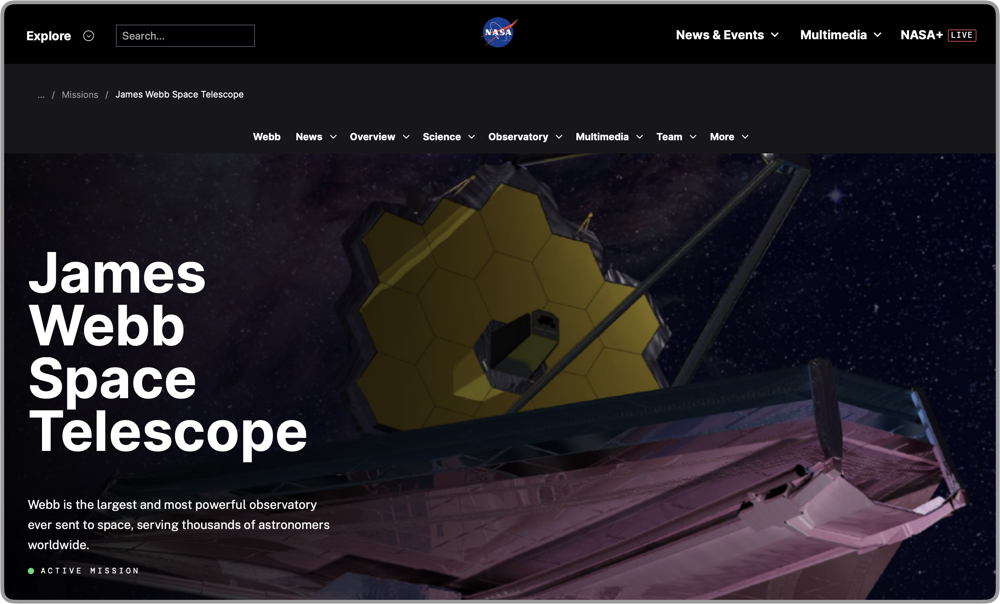
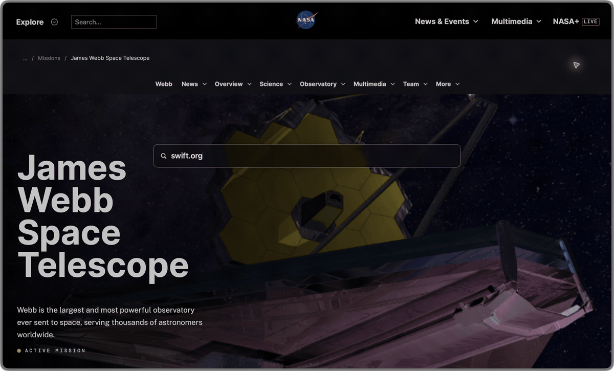

<p align="center">
  
</p>

<h1 align="center">Aria</h1>

<p align="center">A minimal, native browser for macOS.</p>

<p align="center">
  <strong><a href="https://github.com/ryankuah/aria-browser/releases">Download for Mac</a></strong>
  &nbsp; · &nbsp;
  <a href="https://github.com/ryankuah/aria-browser/issues">Report an issue</a>
  &nbsp; · &nbsp;
  <a href="docs/development.md">Build from source</a>
</p>

<p align="center"><sub>macOS 15+ &nbsp; · &nbsp; Apple Silicon & Intel &nbsp; · &nbsp; SwiftUI + WebKit</sub></p>

> [!WARNING]
> **Under active development.** Aria is experimental and not yet polished. Features may be incomplete, and bugs may affect browsing, downloads, or saved data. Use it as a secondary browser, keep backups of important data, and avoid relying on it for sensitive or critical tasks.



<p align="center"><sub>Captured in Aria 1.5.4, the current development build. Public releases may differ.</sub></p>

## More room for the web

Aria gives almost the entire window to the page. A thin bezel frames what you’re reading, watching, or working on.

A fresh profile opens with the page, an on-demand address field and keyboard shortcuts. The optional standard layout adds the edge-hover sidebar shown here.

## A new tab, without losing your place

Press **⌘ T** and a floating search field appears over your current page. Type a website or search query, then press **Return** to open it. Your page stays in view until you’re ready to go.

Suggestions help you return to visited pages and switch to tabs you already have open.



## Familiar controls. A lighter interface.

Swipe with two fingers to move back and forward through your browsing history. Adjust page zoom from the keyboard. In the standard layout, use **⌘ F** to find text and **⌘ G** to step through matches.

Built with **SwiftUI and WebKit**, Aria uses the web engine supplied with macOS.


## The everyday details

| Feature | What you can do |
| --- | --- |
| **Tabs & bookmarks** | Drag to reorder tabs, keep favourite sites in the bookmark shelf, and mute tabs playing audio. |
| **Session restore** | Return to your open tabs after relaunching, or reopen a tab you just closed. |
| **Downloads** | See progress and transfer speed, open completed files, and reveal them in Finder. |
| **Your choice of search** | Choose Google, DuckDuckGo, or Brave. |
| **Userscripts** | Customise websites with JavaScript, URL matching, and optional sidebar buttons. |
| **Saved passwords** | Save website passwords in the macOS Keychain and autofill returning logins. |
| **Site permissions** | Control camera and microphone access for the current website. |
| **Appearance** | Choose a simple bezel, or Liquid Glass on macOS 26 and later. |

## Customize the layout

A fresh profile places only the WebView in the window. Two JavaScript files supply the floating address field (**⌘L** or **⌘T**) and keyboard bindings. Aria provides the window, page engine, internal History and Settings pages, layout editor and native security prompts.

For the sidebar, download controls, quick settings, find bar, console and notifications shown in the demos, open **View → Customize Layout…**. In the **…** menu, choose **Install Add-ons → Install All**, then **Use Standard Layout**, then **Save**. Installation copies missing JavaScript files into your profile immediately and preserves edited files. The layout choice takes effect on Save.

### The layout editor

Open **View → Customize Layout…** (⌥⌘L). It fills the window and has four parts:
- **Layers**, on the left, lists what's placed. Components inside another component's slot are indented under it.
- **The strip** above the preview lists what you can place: the WebView, each component, and a **hover area** for each component that opens on hover.
- **The preview**, in the middle, is drawn with the real controls.
- **The inspector**, on the right, shows the selected item.

How placing works:
- **Placing.** Drag anything from the strip onto the window. Drag to move it anywhere, and use the handles to resize it. Hold ⇧ to snap to edges and neighbours.
- **Slots.** Some components have slots, like the Sidebar's row of buttons. While you drag, slots are outlined; drop a component into one and it lines up with the others there. Drag it out to place it in the window again.
- **Docking.** Drag the WebView's edges to make room. Drop a component beside it and it fills the gap; dragging its inner edge resizes both. Hold ⌥ to place it freely instead. When a docked component closes, the WebView grows back into the space, unless you turn off **Fill gaps of closed components**.
- **Parts.** Double-click a component that's made of parts, like the Sidebar, to edit them. Click a part to select it, or drag it into another row or column. The strip above the preview then lists the parts the layout doesn't use, plus spacers, dividers, rows and columns, ready to drag in. The inspector moves, wraps, groups, sizes and pads the selected part. **Save** writes the new arrangement into the component's file.
- **What shows.** Components that something opens are hidden until you select them, so the window looks as it does when they're closed. Hover areas are drawn in orange. Double-click a hover area to show what it opens. Double-clicking a component without parts opens its file.

Press **Save** (⌘S) to apply the layout, or **Cancel** to discard your changes.

### Component files

Use **Open Components Folder** in the editor to add, edit or remove a JavaScript file. Switch back to Aria or choose **Reload Components** to load it. Deleted files stay removed across launches. Choose an individual bundled file under **Install Add-ons**, then place it in the layout if it draws a panel. The separate Video Controls userscript is off on new installs and can be enabled in Settings.

Aria stores the installed files in `Components/`, their type declarations in `aria.d.ts` and the window layout in `ui-config.json` under `~/Library/Application Support/com.ryankuah.browser/`. When upgrading an older layout format, Aria backs up the layout and the component directory with their old version number and installs the standard layout.

For example, save this as `Components/DownloadCount.js`, reload the components and drag **DownloadCount** from the editor strip into the window.

```js
// @ts-check
/// <reference path="../aria.d.ts" />

export default defineComponent({
  name: "DownloadCount",
  icon: "arrow.down.circle",
  width: 36,
  height: 30,
  render: (props, state) => button({
    icon: "arrow.down.circle",
    badge: state.activeDownloadCount,
    help: "Open Downloads Folder",
    action: "openDownloadsFolder",
  }),
});
```

A component can draw where it is placed, open as an overlay, or provide only key bindings and command handlers with `opensAs: "none"`. Use `hover({ edge, size, closeDelay })`, `shortcut(keys)` or `when(test)` to control visibility. A component with `alwaysOpen: false` can be opened by another component. Use `slot("name")` to accept children in the editor.

`render(props, state, local)` returns a tree of native controls. Choose from rows, columns, layers, scrolling areas, text, icons, favicons, buttons, switches, progress bars, text fields, window controls and drag regions. Pieces can have tap actions, context menus, drag payloads, drop handlers and hover styles.

**Parts** split a component into pieces the layout editor can rearrange. Instead of `render`, give `parts`, each drawing one thing, and a `layout` that arranges them:

```js
export default defineComponent({
  name: "Toolbar",
  parts: {
    back: { title: "Back", icon: "chevron.left", render: (props, state) =>
      button({ icon: "chevron.left", action: "back", enabled: state.canGoBack }) },
    address: { title: "Address bar", render: (_, state) => button({ label: state.host || "Open location", action: "editAddress" }) },
  },
  // <aria:layout>
  layout: row([part("back"), part("address", { grow: true }), slot("buttons")]),
  // </aria:layout>
});
```

- A layout is made of `row`, `column`, `spacer`, `divider`, `part("name")` and `slot("name")`. It's fixed: it can't read props or state, but a part can draw nothing.
- The `<aria:layout>` comments mark the lines the editor rewrites when you save. The parts and everything else in the file stay as you wrote them. Without the markers, the editor shows the parts but can't change them.
- A part that fails to render shows a warning sign, and the rest of the component keeps working.

Any piece takes `grow`, `width`, `height` and `padding`. A `false` or `null` child is skipped, so `state.isLoading && text("Loading")` works.

Use a command name for simple actions or supply an argument, such as `run("selectTab", tab.id)`. A function action receives `(aria, state, local, event)`. It can update local state, open or close components, navigate, open tabs and run commands. Use `keys` to bind an action and `handles` to supply its behavior when invoked from a menu, shortcut or another add-on. Local state resets when the component closes.

Every component receives the active page address, navigation availability, appearance, tab count and active download count. Declare additional data in `uses`, for example `uses: ["tabs", "downloads"]`. Other available sections include bookmarks, page details, settings, userscripts, console messages and download notices. The browser handles permission grants and password prompts in native UI.

See the [typed component API](Browser/Resources/PanelDefaults/aria.d.ts) for all controls, state fields and commands. The [bundled components](Browser/Resources/PanelDefaults/Components) include working examples of suggestions, drag-and-drop, keyboard bindings and conditional panels. Files run in disposable WebKit workers with a one-second time limit. The editor reports load and render errors.

## Get Aria

1. Download the DMG from [GitHub Releases](https://github.com/ryankuah/aria-browser/releases).
2. Open it and drag **Aria** into **Applications**.
3. Launch Aria and press **⌘ T** to start browsing.

Requires **macOS 15 or later**. Install updates from the releases page.

<details>
<summary><strong>Keyboard shortcuts</strong></summary>

| Action | Shortcut |
| --- | --- |
| Open a new tab | ⌘ T |
| Close the current tab | ⌘ W |
| Reopen a closed tab | ⇧ ⌘ T |
| Find in page | ⌘ F |
| Next / previous match | ⌘ G / ⇧ ⌘ G |
| Show history | ⌘ Y |
| Copy the page link | ⇧ ⌘ C |
| Zoom in / out / reset | ⌘ + / ⌘ − / ⌘ 0 |

</details>

<details>
<summary><strong>Build and release</strong></summary>

Open `Browser.xcodeproj` in **Xcode 26 or newer**, select the `Browser` scheme and your development signing team, then run.

See the [development guide](docs/development.md) for DMG packaging, signing, and notarisation.

</details>

---

Made by [Ryan Kuah](https://ryankuah.com). Website content shown in the demos belongs to [NASA](https://science.nasa.gov/mission/webb/) and [Swift.org](https://www.swift.org/).
