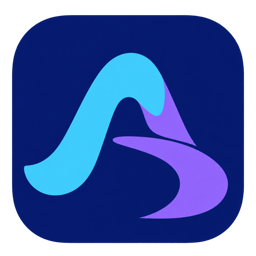
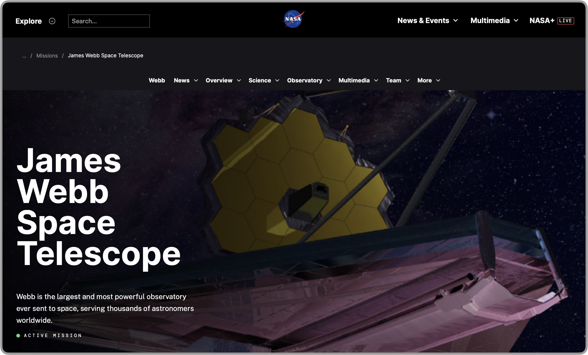
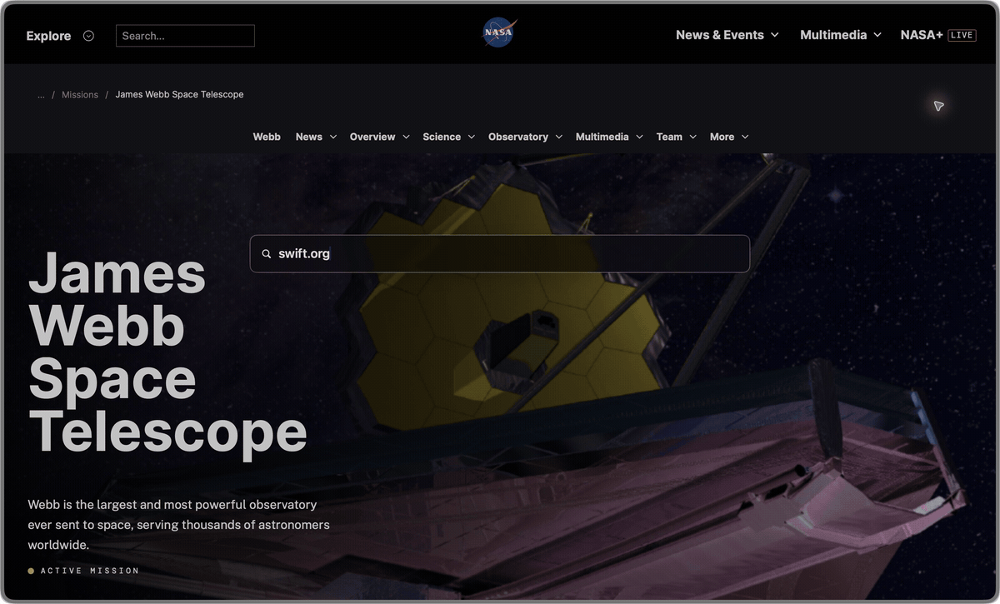

  

<h1 align="center">Aria</h1>

A minimal, native browser for macOS.

  <strong><a href="https://github.com/ryankuah/browser/releases">Download for Mac</a></strong>
  &nbsp; · &nbsp;
  <a href="https://github.com/ryankuah/browser/issues">Report an issue</a>
  &nbsp; · &nbsp;
  <a href="docs/development.md">Build from source</a>

macOS 15+ &nbsp; · &nbsp; Apple Silicon & Intel &nbsp; · &nbsp; SwiftUI + WebKit

> [!WARNING]
> **Under active development.** Aria is experimental and not yet polished. Features may be incomplete, and bugs may affect browsing, downloads, or saved data. Use it as a secondary browser, keep backups of important data, and avoid relying on it for sensitive or critical tasks.

Captured in Aria 1.5.4, the current development build. Public releases may differ.

## More room for the web

Aria gives almost the entire window to the page. A thin bezel frames what you’re reading, watching, or working on.

Move your pointer to the left edge to reveal your tabs, bookmarks, and navigation controls. Move back to the page and the sidebar slips away.

## A new tab, without losing your place

Press **⌘ T** and a floating search field appears over your current page. Type a website or search query, then press **Return** to open it. Your page stays in view until you’re ready to go.

Suggestions help you return to visited pages and switch to tabs you already have open.

## Familiar controls. A lighter interface.

Swipe with two fingers to move back and forward through your browsing history. Find text with **⌘ F**, step through matches with **⌘ G**, and adjust page zoom from the keyboard.

Built with **SwiftUI and WebKit**, Aria uses the web engine supplied with macOS.

## The everyday details

| Feature | What you can do |
| --- | --- |
| **Tabs & bookmarks** | Drag to reorder tabs, keep favourite sites in the bookmark shelf, and mute tabs playing audio. |
| **Session restore** | Return to your open tabs after relaunching, or reopen a tab you just closed. |
| **Downloads** | See progress and transfer speed, open completed files, and reveal them in Finder. |
| **Your choice of search** | Choose Google, DuckDuckGo, or Brave. |
| **Userscripts** | Customise websites with JavaScript, URL matching, and optional sidebar buttons. |
| **Saved passwords** | Save website passwords in the macOS Keychain and autofill returning logins. |
| **Site permissions** | Control camera and microphone access for the current website. |
| **Appearance** | Choose a simple bezel, or Liquid Glass on macOS 26 and later. |

## Get Aria

1. Download the DMG from [GitHub Releases](https://github.com/ryankuah/browser/releases).
2. Open it and drag **Aria** into **Applications**.
3. Launch Aria and press **⌘ T** to start browsing.

Requires **macOS 15 or later**. Install updates from the releases page.

<strong>Keyboard shortcuts</strong>

| Action | Shortcut |
| --- | --- |
| Open a new tab | ⌘ T |
| Close the current tab | ⌘ W |
| Reopen a closed tab | ⇧ ⌘ T |
| Find in page | ⌘ F |
| Next / previous match | ⌘ G / ⇧ ⌘ G |
| Show history | ⌘ Y |
| Copy the page link | ⇧ ⌘ C |
| Zoom in / out / reset | ⌘ + / ⌘ − / ⌘ 0 |

<strong>Build and release</strong>

Open `Browser.xcodeproj` in **Xcode 26 or newer**, select the `Browser` scheme and your development signing team, then run.

See the [development guide](docs/development.md) for DMG packaging, signing, and notarisation.

---

Made by [Ryan Kuah](https://ryankuah.com). Website content shown in the demos belongs to [NASA](https://science.nasa.gov/mission/webb/) and [Swift.org](https://www.swift.org/).
